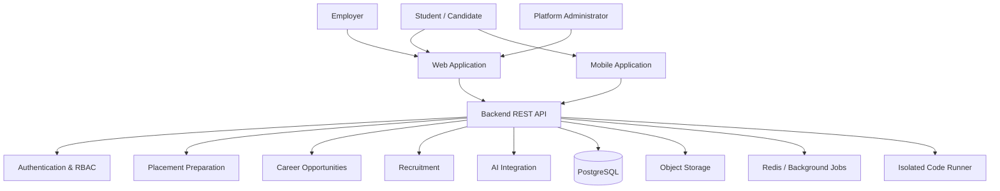

# 🚀 PrePilot

### Prepare. Prove. Connect. Get Hired.

**An AI-powered placement preparation and career recruitment ecosystem.**

PrePilot is a unified platform designed to bridge the gap between academic learning and professional employment. It empowers students to evaluate their placement readiness, strengthen technical skills, receive AI-driven guidance, discover career opportunities, and connect with employers.

Our goal is simple: help every student become career-ready and make the journey from preparation to placement smarter, more accessible, and more effective.

<p align="center">

**One Platform. Every Step Towards Your Career.**

</p>

---

## 🌐 The Vision

Students often use multiple disconnected platforms for learning, coding practice, resume building, job searching, and placement preparation.

PrePilot brings these experiences together into one connected ecosystem.

We envision a platform where students can:

- Understand their current placement readiness.
- Identify strengths and areas that need improvement.
- Follow personalized preparation recommendations.
- Practice aptitude, DSA, and core computer science.
- Get intelligent assistance through AI.
- Discover relevant job opportunities.
- Apply for jobs and track applications.
- Connect with companies and recruitment teams.

## ✨ Platform Ecosystem

PrePilot is built around four interconnected modules.

### 🎓 01. Placement Preparation

**Build skills. Measure readiness. Improve continuously.**

- Placement readiness assessment.
- Aptitude preparation and practice.
- Data Structures and Algorithms.
- Core Computer Science subjects.
- AI-powered learning assistant.
- Resume management and improvement.
- Personalized learning recommendations.
- Progress tracking and performance analytics.

### 💼 02. Career Opportunities

**Discover opportunities that match your skills.**

- Job and internship discovery.
- Personalized eligibility matching.
- Job bookmarking and saved opportunities.
- Online job applications.
- Application status tracking.
- Career opportunity recommendations.

### 🏢 03. Employer & Recruitment

**Help companies discover and recruit emerging talent.**

- Company registration and verification.
- Employer dashboard.
- Job and internship posting.
- Candidate discovery.
- Candidate shortlisting.
- Interview management.
- Recruitment workflow tracking.

### ⚙️ 04. Platform Administration

**Manage and maintain the PrePilot ecosystem.**

- Student and employer management.
- Company verification.
- Job moderation.
- Platform analytics.
- Support management.
- Audit logs and administrative controls.

---

## 🧠 What Makes PrePilot Different?

| Capability | Purpose |
|---|---|
| AI-powered guidance | Intelligent learning assistance |
| Placement readiness score | Understand preparation levels |
| Skill assessment | Identify strengths and weaknesses |
| Adaptive recommendations | Prioritize what to learn next |
| Unified career ecosystem | Connect preparation with opportunities |
| Recruitment integration | Bridge students and employers |

## 🏗️ System Architecture

PrePilot follows a **modular monolith architecture** for its initial backend implementation, allowing the platform to remain maintainable and scalable without introducing unnecessary distributed-system complexity.



*Conceptual architecture: components will be implemented progressively.*

## 🛠️ Technology Stack

The following technologies have been selected for the platform architecture.

| Layer | Technology |
|---|---|
| Web application | Next.js |
| Programming language | TypeScript |
| Mobile application | React Native + Expo |
| Backend framework | NestJS |
| Database | PostgreSQL |
| ORM | Prisma |
| Caching and queues | Redis + BullMQ |
| API architecture | REST API |
| File storage | S3-compatible storage |
| AI integration | Provider-independent AI layer |
| Code execution | Isolated execution service |
| Version control | Git + GitHub |
| Development environment | Visual Studio Code |

**Architecture principle:** Shared contracts, modular backend development, secure APIs, and reusable components across applications.

## 📂 Repository Structure

```text
PrePilot/
│
├── apps/
│   ├── web/                 # Web application
│   ├── mobile/              # Mobile application
│   ├── api/                 # Backend API
│   └── admin/               # Admin application (future)
│
├── services/
│   ├── code-runner/         # Isolated code execution
│   └── workers/             # Background processing
│
├── docs/
│   ├── APP_MODULES.md       # Application architecture
│   └── SERVICES.md          # Backend services architecture
│
├── .gitignore
└── README.md
```

## 🔐 Security & Engineering Principles

Security and reliability are foundational requirements.

- Role-Based Access Control (RBAC).
- Secure authentication and authorization.
- Environment-based configuration and secret management.
- API input validation.
- Protected application routes.
- Secure file uploads and storage.
- Isolated code execution with resource limits.
- Background job reliability and error handling.
- Maintainable and modular code organization.

## 🗺️ Development Roadmap

PrePilot is being developed incrementally, with placement preparation as the initial product priority.

| Phase | Focus | Priority |
|---|---|---|
| Phase 1 | Placement Preparation Core | 🔴 High |
| Phase 2 | Career Opportunities | 🟠 Next |
| Phase 3 | Employer & Recruitment | 🟡 Future |
| Phase 4 | Platform Administration | 🟡 Future |
| Phase 5 | Production Readiness & Launch | 🟢 Future |

## 📊 Project Status

**Current stage: Architecture & Development Foundation**

| Area | Status |
|---|---|
| Product vision and planning | ✅ Completed |
| Application architecture | ✅ Documented |
| Backend services architecture | ✅ Documented |
| Git and GitHub setup | ✅ Completed |
| Project foundation | 🚧 In progress |
| Web application | 📋 Planned |
| Mobile application | 📋 Planned |
| Backend API | 📋 Planned |
| AI integration | 📋 Planned |
| Employer recruitment | 📋 Planned |

*The status above reflects the current development stage. Planned features are not yet represented as completed functionality.*

## 🚀 Getting Started

### Prerequisites

- [Node.js](https://nodejs.org/)
- [npm](https://www.npmjs.com/)
- [Git](https://git-scm.com/)
- [Visual Studio Code](https://code.visualstudio.com/)

### Clone the repository

```bash
git clone https://github.com/Lakshmeesha03ke/PrePilot-Platform.git

cd PrePilot-Platform
```

### Development setup

Application-specific installation, environment configuration, database setup, and execution instructions will be documented as each component is implemented.

## 📚 Documentation

Explore the architecture documentation:

- [Application Modules](docs/APP_MODULES.md)
- [Backend Services](docs/SERVICES.md)

## 🎯 Long-Term Goal

PrePilot aims to become a complete placement and recruitment ecosystem, initially focused on students and fresh graduates in India, with the potential to expand globally.

We want to make quality placement preparation accessible, provide meaningful career opportunities, and help employers discover capable emerging talent.

---

<p align="center">

### PREPARE. PROVE. CONNECT. GET HIRED.

**Building a smarter bridge between students and opportunities.**

Made with ❤️ for the next generation of talent.

</p>